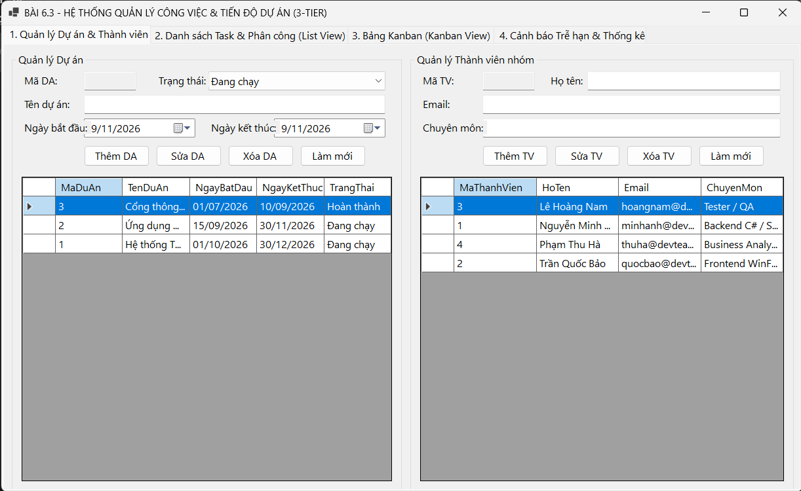
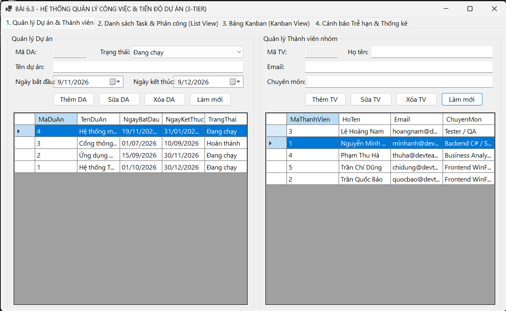
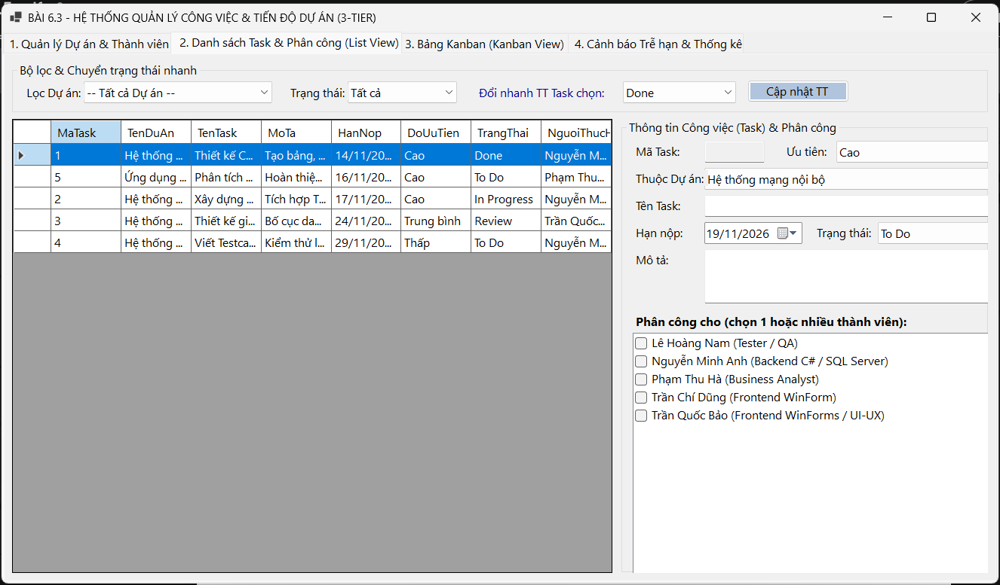
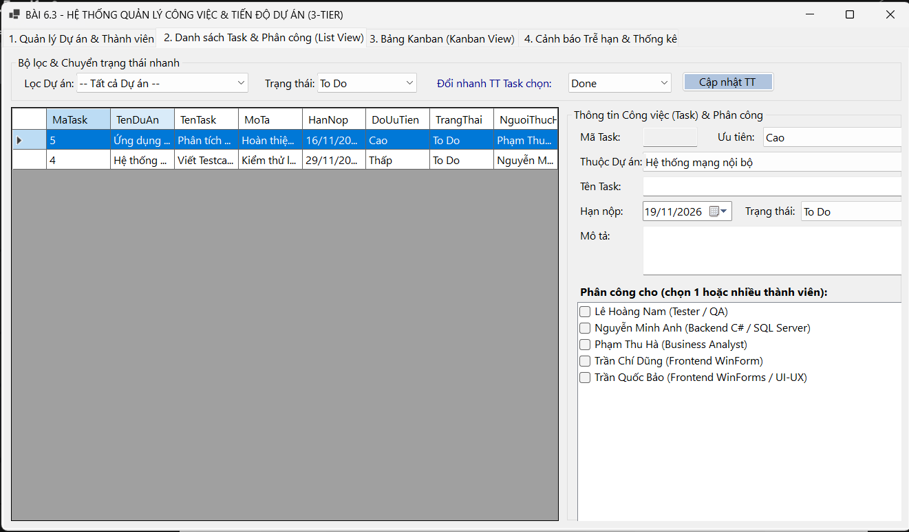
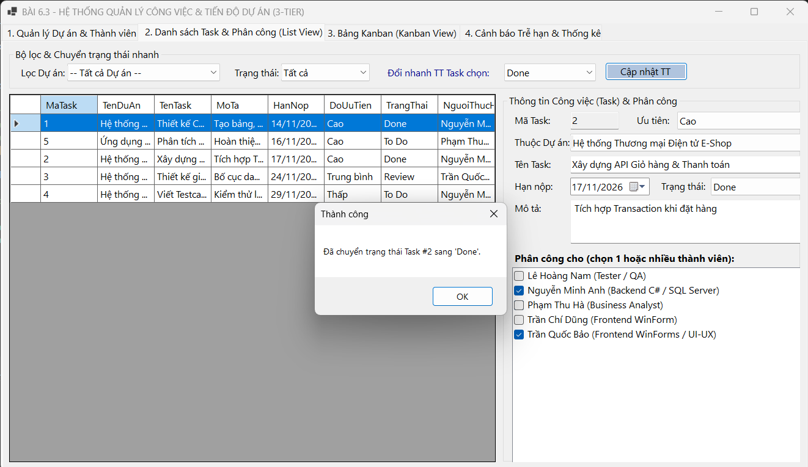
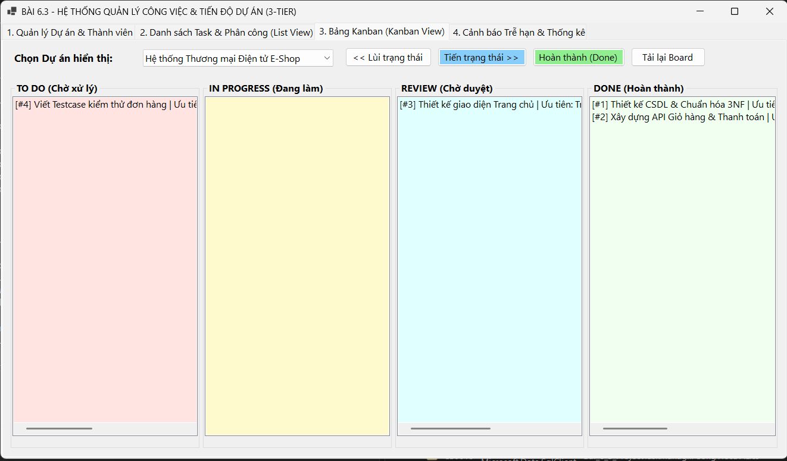
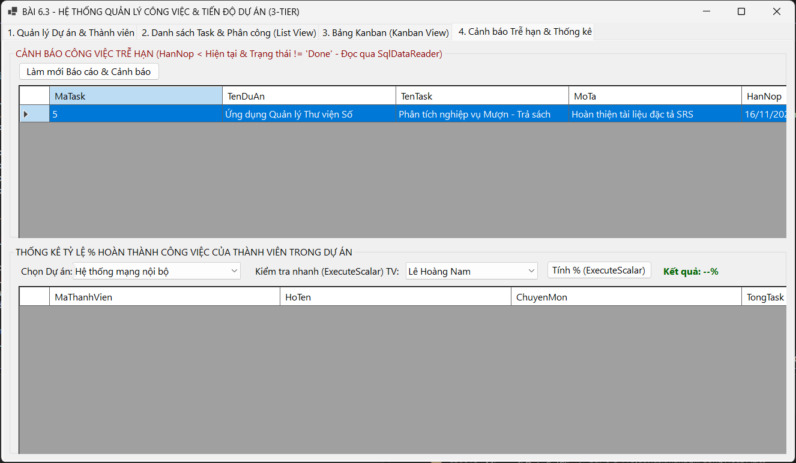

# BÁO CÁO BÀI TẬP

## THÔNG TIN SINH VIÊN
- **Họ và tên:** Lương Quốc Cường
- **Mã số sinh viên:** 24810310195
- **Lớp:** D19CNPM3
- Bài 6.1: HỆ THỐNG QUẢN LÝ BÁN HÀNG & SIÊU THỊ MINI (RETAIL SALES SYSTEM)

---

## MỤC ẢNH KẾT QUẢ CHỨC NĂNG
### 1. Màn hình Chính / Tổng quan hệ thống:

### 2. Màn hình Quản lý Danh mục (CRUD - Thêm/Sửa/Xóa):

### 3. Màn hình Thực thi Nghiệp vụ chính (Lập Hóa đơn / Bán hàng / Chấm công / Đặt phòng):

### 4. Màn hình Báo cáo - Thống kê:

### 5. Minh họa An toàn Dữ liệu (Phòng chống SQL Injection / Báo lỗi Transaction Rollback):

